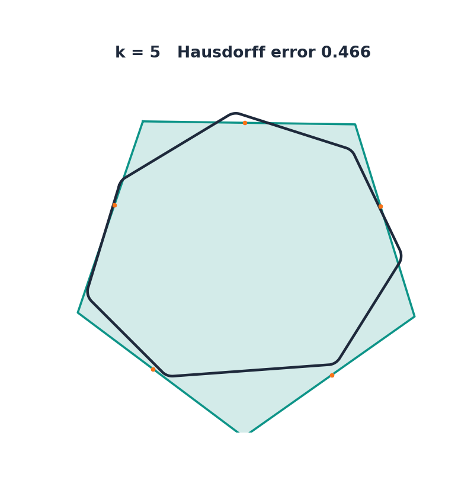
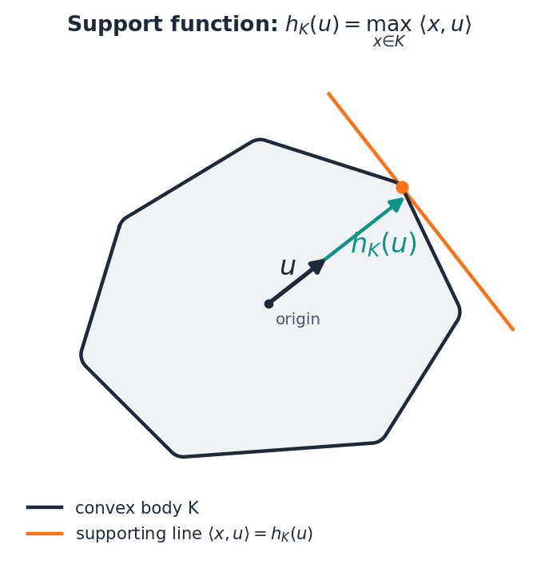
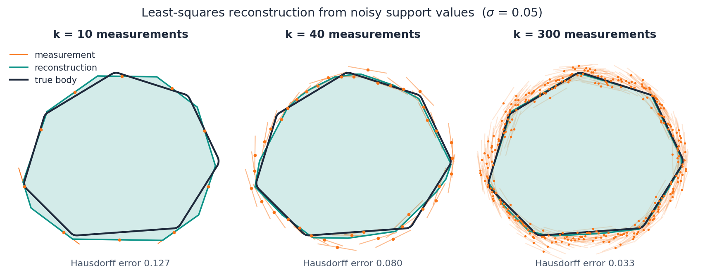
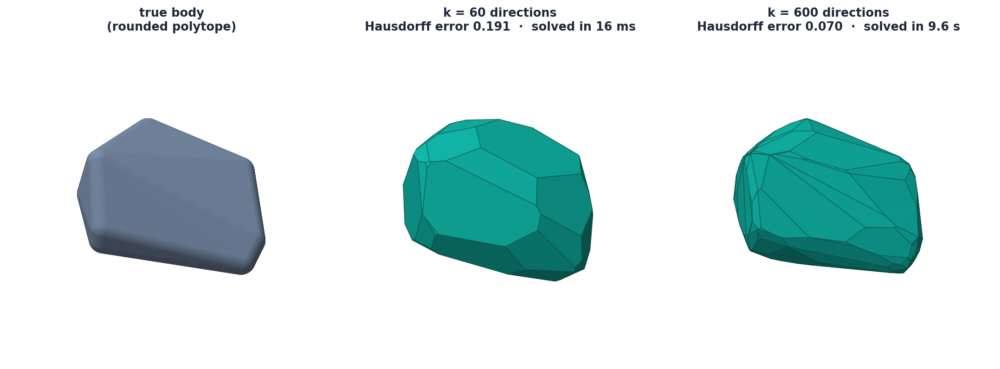
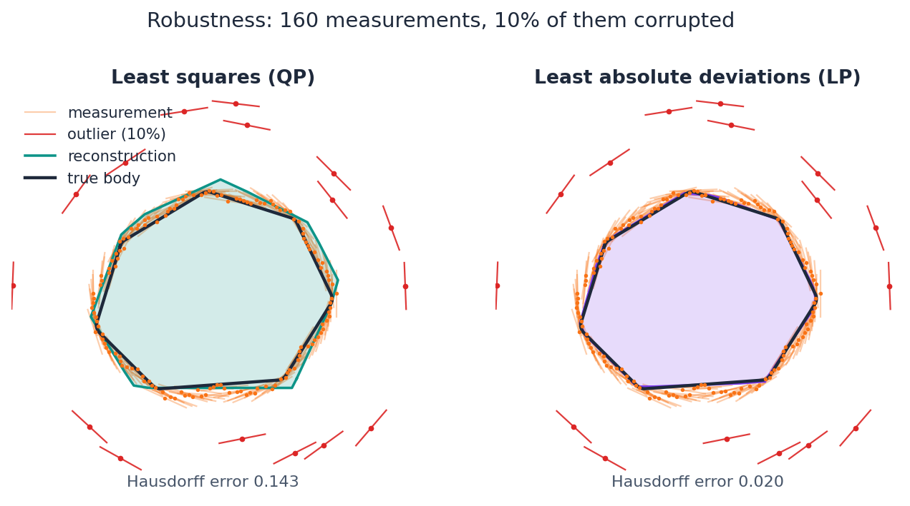
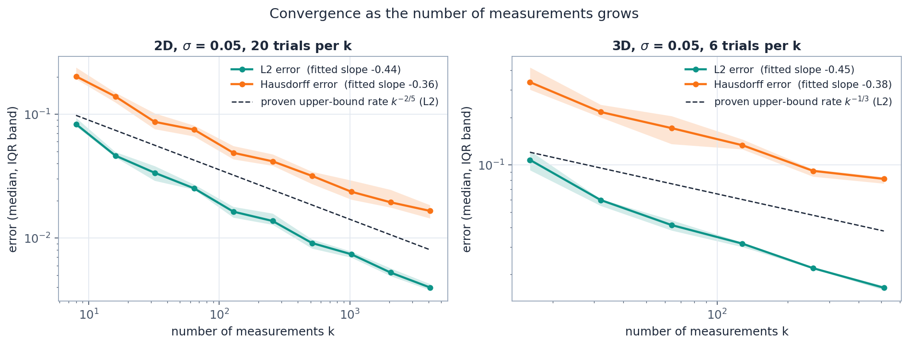

# convex-recon

**Reconstruct an unknown convex shape in 2D or 3D from noisy measurements of its support function.**

<p align="center">
  
</p>

Imagine probing an object you can't see: for each direction `u` you learn (with noise) how far the
object extends in that direction. That number is the **support function**
`h_K(u) = max_{x in K} <x, u>`. Such measurements come from tactile and laser-stripe probes in
robotics, from the extent of projections (shadows) in tomography, and from line-scan sensors. This
library recovers the shape from them with a convex program, with convergence guarantees from the
geometric-tomography literature.

<p align="center">
  
</p>

## Results

**2D:** least-squares reconstruction of a rounded heptagon from 10, 40 and 300 noisy measurements
(σ = 0.05). Each orange segment is a measured supporting line.



**3D:** the same estimator on the sphere of directions. A 600-direction problem (360,000
pairwise constraints) solves in about 10 s on a laptop thanks to constraint generation (see below).



**Robustness:** replacing squared error with absolute error gives a linear program that ignores gross
outliers.



**Convergence:** as the number of measurements `k` grows, the error shrinks. Gardner, Kiderlen &
Milanfar (2006) prove that the L2 error is `O(k^-2/5)` in 2D and `O(k^-1/3)` in 3D. These are
worst-case upper bounds, and the measured slopes are steeper.



## Running it

```bash
git clone https://github.com/garikdza/Convex_Body_Reconstruction
cd Convex_Body_Reconstruction
uv sync                                   # installs NumPy, SciPy, cvxpy, matplotlib
uv run pytest                             # run the tests
uv run python examples/figures.py         # rebuild the figures in docs/img/
uv run python examples/convergence.py     # rerun the benchmark
```

Requires Python ≥ 3.10. Without [uv](https://docs.astral.sh/uv/), use `pip install -e .` in a
virtualenv.

## Quick start

```python
import numpy as np
import src as cr

# an unknown body: a random polygon with rounded corners (Minkowski sum with a disk)
K = cr.random_polygon(7, rng=0) + cr.Ellipsoid(0.1 * np.eye(2), np.zeros(2))

U = cr.circle_directions(200)                # measurement directions (k, 2)
y = cr.measure(K, U, sigma=0.05, rng=1)      # noisy support values

rec = cr.reconstruct(U, y)                   # least squares; method="lad" for the robust LP
print(rec.polytope.vertices)                 # the estimate is a polygon
print(cr.hausdorff_distance(K, rec.polytope))
```

In 3D, use `cr.sphere_directions(k)` and a 3D body such as `cr.random_polytope(n)` or `cr.Ellipsoid(A, c)`.

## How it works

Given directions `u_1 … u_k` and measurements `y_i = h_K(u_i) + noise`, solve

```
minimise    Σ_i  loss(y_i − h_i)
subject to  h_1 … h_k are consistent  (they are the support values of some convex body)
```

and return the polytope `P = { x : <x, u_i> ≤ h_i  for all i }`. This is *Algorithm
NoisySupportLSQ* of Gardner, Kiderlen & Milanfar (2006), originally due to Prince & Willsky (1990).
With `loss = square` it is a quadratic program. With `loss = |·|` (`method="lad"`) it is a linear
program.

The work is in expressing consistency as linear constraints. Two formulations are implemented:

| | constraint | size | used for |
|---|---|---|---|
| **pairwise** (any dimension) | ∃ contact points `x_i` with `<x_i, u_i> = h_i` and `<x_j, u_i> ≤ h_i` ∀ i, j | `dk` variables, `k²` constraints | 3D |
| **local** (2D) | with directions sorted by angle, `h_{i−1} sin(θ_{i+1}−θ_i) − h_i sin(θ_{i+1}−θ_{i−1}) + h_{i+1} sin(θ_i−θ_{i−1}) ≥ 0`: every edge touches the polygon cut out by its neighbours | `k` constraints | 2D, up to `k` = 20,000 in under a second |

The `k²` pairwise constraints are what made 3D reconstruction expensive. Nearly all of them are
inactive at the optimum, because only nearby directions compete for the same part of the boundary.
So the solver uses **constraint generation**: it starts with each direction's nearest neighbours,
solves, adds every violated constraint and repeats. A relaxed solution that satisfies all
constraints is optimal for the full problem, so the result is exact. Together with sparse constraint
matrices, this cut the k = 400 solve from 55 s (dense, all constraints) to 1.2 s.

The tests check that both 2D formulations give the same optimum and that noise-free data are
reproduced exactly. They also check that a polytope is recovered exactly when its facet normals
are among the measurement directions, that the least-squares estimator is a projection, and that the
LP variant shrugs off outliers.

## Project layout

```
src/
  reconstruct.py   reconstruct(): validates input, picks a formulation, returns the estimate
  solvers.py       the convex programs: 2D local constraints, pairwise + constraint generation
  bodies.py        ConvexBody interface; Polytope, Ellipsoid, Minkowski sums
  geometry.py      halfspace intersection (support values -> polytope vertices)
  directions.py    evenly spread directions on the circle / sphere (Fibonacci lattice)
  simulate.py      random test bodies and the noisy measurement model
  metrics.py       Hausdorff and L2 distances via support functions
  plotting.py      matplotlib helpers used by the examples
examples/
  figures.py       regenerates the README figures (~20 s)
  convergence.py   the convergence benchmark (~1.5 min)
  shapes.py        the example bodies
tests/             pytest suite, one file per module
```

## References

- R. J. Gardner, M. Kiderlen, P. Milanfar. *Convergence of algorithms for reconstructing convex
  bodies and directional measures.* Annals of Statistics 34(3), 2006.
  [arXiv:math/0608011](https://arxiv.org/abs/math/0608011)
- R. J. Gardner, M. Kiderlen. *A new algorithm for 3D reconstruction from support functions.*
  IEEE TPAMI 31(3), 2009.
- J. L. Prince, A. S. Willsky. *Reconstructing convex sets from support line measurements.*
  IEEE TPAMI 12(4), 1990.
- A. S. Lele, S. R. Kulkarni, A. S. Willsky. *Convex-polygon estimation from support-line
  measurements and applications to target reconstruction from laser-radar data.* JOSA A 9(10), 1992.

## License

MIT
