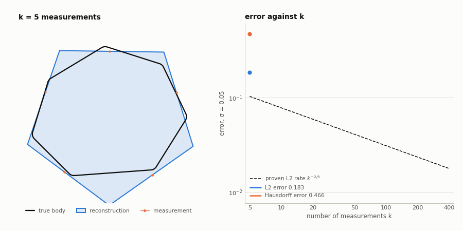
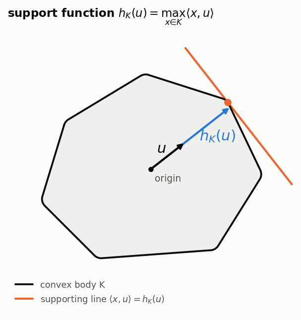
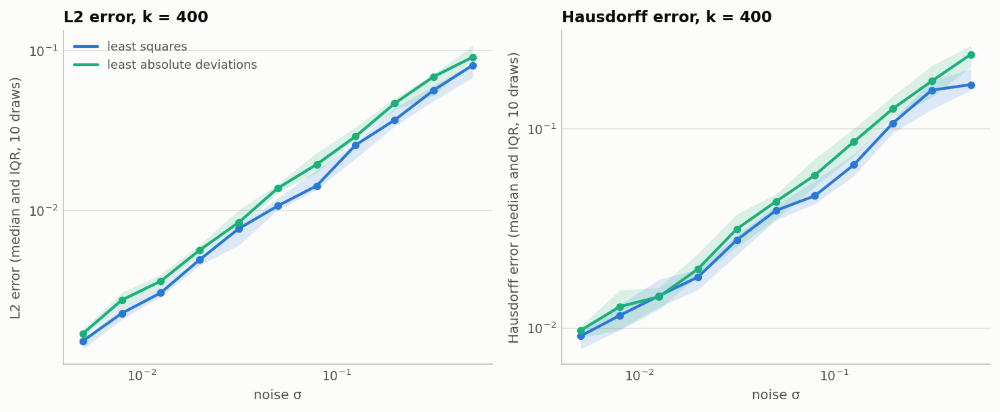
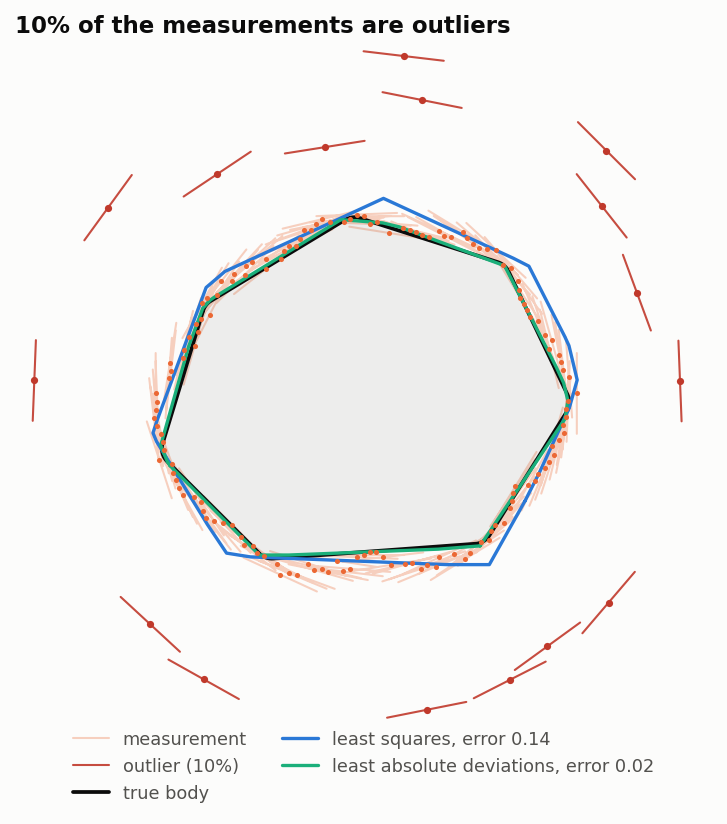

# Convex Body Reconstruction

[](https://codecov.io/gh/garikdza/Convex_Body_Reconstruction)
[](pyproject.toml)
[](LICENSE)

Reconstruction of a convex body in 2D or 3D from noisy measurements of its support function.

<p align="center">
  
</p>
<p align="center"><sub>Reconstruction from k = 5 to 400 noisy measurements</sub></p>

The support function of a convex body K assigns to each unit vector u the value
h<sub>K</sub>(u) = max<sub>x∈K</sub> ⟨x, u⟩, how far K extends in the direction u. Given unit directions u<sub>1</sub>, …, u<sub>k</sub> and measurements
y<sub>i</sub> = h<sub>K</sub>(u<sub>i</sub>) + noise, the estimator finds the support values h<sub>1</sub>, …,
h<sub>k</sub> of a convex body closest to the measurements and returns the polytope
{x : ⟨x, u<sub>i</sub>⟩ ≤ h<sub>i</sub> for all i} ([Prince & Willsky, 1990](https://doi.org/10.1109/34.50623)). As
k grows the polytope converges to K ([Gardner, Kiderlen & Milanfar, 2006](https://doi.org/10.1214/009053606000000335)).

<p align="center">
  
</p>

## Features

**Fits**, chosen with `method`:

| `method`          | fit                                           | solved as         |
| ----------------- | --------------------------------------------- | ----------------- |
| `'lsq'` (default) | least squares                                 | quadratic program |
| `'lad'`           | least absolute deviations, robust to outliers | linear program    |

**Consistency constraints**, chosen with `formulation`, which make h<sub>1</sub>, …, h<sub>k</sub> the support values
of a convex body:

- `'local'` (2D only, the default there): with the directions sorted by angle, each line
  ⟨x, u<sub>i</sub>⟩ = h<sub>i</sub> touches the polygon cut out by its two neighbours, one linear constraint per
  direction ([Lele, Kulkarni & Willsky, 1992](https://doi.org/10.1364/JOSAA.9.001693)). k = 20,000 solves in under a
  second.
- `'pairwise'` (any dimension, the default in 3D): there are points x<sub>i</sub> with
  ⟨x<sub>i</sub>, u<sub>i</sub>⟩ = h<sub>i</sub> and ⟨x<sub>j</sub>, u<sub>i</sub>⟩ ≤ h<sub>i</sub> for all i, j. Only
  the constraints between nearby directions are active at the optimum, so they are added by constraint generation:
  start from each direction's nearest neighbours, solve, add the violated constraints and repeat. The result is
  exact, and k = 600 in 3D solves in under 2 s.

**Bodies**: `Polytope`, `Ellipsoid` and their Minkowski sums (`+`, which adds the support functions), compared with
`hausdorff_distance` and `l2_distance`.

## Install

```bash
git clone https://github.com/garikdza/Convex_Body_Reconstruction
cd Convex_Body_Reconstruction
uv sync
```

## Quickstart

```python
import numpy as np
from src import Ellipsoid, circle_directions, hausdorff_distance, measure, random_polygon, reconstruct

# a random polygon with its corners rounded by a disk of radius 0.1
K = random_polygon(7, rng=0) + Ellipsoid(0.1 * np.eye(2), np.zeros(2))
U = circle_directions(200)                # (200, 2) unit directions
y = measure(K, U, sigma=0.05, rng=1)      # noisy support values

rec = reconstruct(U, y)                   # method='lad' for the robust fit
rec.polytope.vertices                     # the estimate, a polygon
hausdorff_distance(K, rec.polytope)       # its distance to K
```

In 3D, take the directions from `sphere_directions(k)` and a body such as `random_polytope(n)` or `Ellipsoid(A, c)`.

## Examples

[`examples/`](examples) has one script per figure.

<p align="center">
  
</p>
<p align="center"><sub>Least-squares reconstructions from 10, 40 and 300 measurements with noise σ = 0.05.</sub></p>

<p align="center">
  
</p>
<p align="center"><sub>A rounded random polytope and its least-squares reconstructions from 60 and 600 directions with
noise σ = 0.03.</sub></p>

<p align="center">
  
</p>
<p align="center"><sub>Error against the noise level σ with k = 400 directions. With Gaussian noise least squares is
slightly more accurate.</sub></p>

<p align="center">
  
</p>
<p align="center"><sub>With outliers least absolute deviations is the robust choice: least squares is pulled toward
them.</sub></p>

```bash
uv sync --extra examples
uv run --extra examples python examples/reconstruction_2d.py   # also support_function.py, outliers.py, animation_2d.py
uv run --extra examples python examples/reconstruction_3d.py   # saves the fit; --recompute fits again
uv run --extra examples python examples/noise.py               # about 10 s on the first run
uv run --extra examples python examples/convergence.py         # error against k in 2D and 3D, about 30 s
```

## References

- J. L. Prince, A. S. Willsky, "Reconstructing convex sets from support line measurements", *IEEE Transactions on
  Pattern Analysis and Machine Intelligence*, 12(4), 377–389, 1990. https://doi.org/10.1109/34.50623
- A. S. Lele, S. R. Kulkarni, A. S. Willsky, "Convex-polygon estimation from support-line measurements and
  applications to target reconstruction from laser-radar data", *Journal of the Optical Society of America A*, 9(10),
  1693–1714, 1992. https://doi.org/10.1364/JOSAA.9.001693
- R. J. Gardner, M. Kiderlen, P. Milanfar, "Convergence of algorithms for reconstructing convex bodies and
  directional measures", *Annals of Statistics*, 34(3), 1331–1374, 2006. https://doi.org/10.1214/009053606000000335
- R. J. Gardner, M. Kiderlen, "A new algorithm for 3D reconstruction from support functions", *IEEE Transactions on
  Pattern Analysis and Machine Intelligence*, 31(3), 556–562, 2009. https://doi.org/10.1109/TPAMI.2008.190

## License

Released under the [MIT License](LICENSE), © 2020 [garikdza](https://github.com/garikdza).
